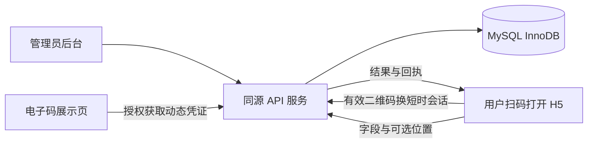

# 通用轻量签到工具｜技术论证与开发 Spec

版本：v1.4 · 2026-10-14

本次修订：按用户最新指令移除固定身份类型／身份字段，改为自定义字段独立控制是否允许重复。其余技术选型和验收边界保持，具体完成范围见 `docs/implementation-status.md`。

用途：产品范围确认、技术选型、开发拆分与验收。本文定义目标范围；目前已有核心开发版本与本机验证，详见 `docs/implementation-status.md`。地图服务、真机兼容性与生产环境验证仍待完成，不代表本 Spec 全部验收通过。

## 1. 产品结论与已确认范围

制作一个独立、轻量的活动签到工具：管理员创建活动、配置字段和签到规则，按需导入名单；用户扫描现场电子展示的活动二维码，打开手机网页并提交签到。

**唯一扫码逻辑：用户扫活动签到码，一个码只对应一个活动。** 不设计工作人员扫描用户个人码的流程。二维码用于电子展示，不存在纸质码；本期建议统一使用动态码，不安排长期静态码入口。

| 项目 | 已确认的需求 |
| --- | --- |
| 使用场景 | 同时支持内部活动、对外活动 |
| 规模 | 单场通常不超过 1,000 人 |
| 参与端 | 推荐手机扫码打开 H5，无须安装 App |
| 身份验证 | 不使用手机验证码；手机号可以作为填写字段或身份标识 |
| 表单 | 管理员配置自定义字段 |
| 导入 | 支持导入活动参与名单，并可将其作为白名单 |
| 签到码 | 活动级电子二维码，支持动态刷新 |
| 定位 | 支持 iPhone／安卓、不同定位来源的坐标体系适配及活动位置范围判断 |
| 地图 | 管理员通过地图搜索、点选或拖动设置活动中心，预览签到范围 |
| 数据库评估 | 评估 MySQL 作为数据存储与事务基础，见 10.4 |
| UI 评估 | 评估后台、手机签到端及电子码的组件库与响应式需求，见 10.5 |
| 防重复 | 每个关闭“允许重复”的字段值在同一活动只能出现于一条签到记录；不强制指定身份字段 |
| 风控记录 | IP、浏览器设备标识、客户端信息、位置校验结果等 |
| 产品形态 | 轻量 TOOL，以活动、名单、签到、导出为核心 |

**关键能力边界：** 普通手机网页无法获取设备 MAC；IP 和浏览器标识都不能可靠识别自然人；不核验身份时，可以防止同一标识重复签到，但不能保证同一个人不会冒用或更换标识。动态码、定位和设备记录应组成分层风控，而非承诺绝对防代签。

前端使用 Vue 已由用户确认。下文其余默认值、具体库版本、后端技术栈和扩展项仍是建议，不是已经由用户确认的要求。

## 2. 目标与本期边界

### 2.1 产品目标

1. 管理员用少量步骤完成建活动、配字段、导入名单、展示签到码。
2. 用户无登录、无短信验证码，扫码后填写必要信息并签到。
3. 后台能够解释每笔签到为什么通过、拒绝或需要人工核验。
4. 名单、签到结果和风险记录可以检索、导出并按保留策略删除。
5. 单台应用实例加一个数据库作为首期部署起点，经过压测验证后确定资源配置，减少长期运维负担。

### 2.2 本期不实现

原生 App、小程序、短信验证、收费票务、营销系统、人脸识别、身份证 OCR、设备指纹追踪、跨活动实名身份系统、离线自动签到、用户个人二维码和工作人员反向扫码。

企业单点登录、多组织 SaaS、自助注册和计费也不作为首期必需项。内部与外部活动可在同一后台创建，不因此增加两套系统。

## 3. 技术论证：哪些能力成立

| 能力 | 可行性与实现方式 | 必须接受的限制 |
| --- | --- | --- |
| 动态活动二维码 | 可行。服务端签发短时凭证，电子展示页定期刷新 | 截图可在有效期内转发，实时视频转播也无法完全阻止 |
| 同标识防重复 | 可行。规范化身份字段，数据库唯一约束与事务兜底 | 换身份标识、冒用他人标识仍可能发生 |
| 地理围栏 | 可行。HTTPS 下经用户授权取得位置，服务端计算距离 | 室内误差、授权拒绝、定位伪造；不能证明真实在场 |
| 公网 IP 记录 | 可行。由后端从可信网络入口取得 | Wi-Fi 下多人可能同 IP；移动网络、VPN 会改变 IP |
| 局域网 IP | 不适合作为产品依赖 | 浏览器与 WebRTC 隐私限制、网络环境差异，获取并不稳定 |
| MAC 地址 | 通用 H5 不可行 | MAC 是链路层信息，不随跨互联网 HTTP 请求传到服务端；标准网页无读取设备 MAC 的 API |
| 浏览器设备标识 | 可行。第一方 Cookie 中生成随机标识 | 只代表一个浏览器存储环境；无痕、清除数据、换浏览器可产生新标识 |
| 真实身份核验 | 本期不保证 | 自填姓名、手机、员工号和匹配名单不等于证明本人 |

### 3.1 对 MAC 需求的处理

建议将“记录 MAC”改成“记录随机浏览器设备标识”。数据库与界面明确命名为 `browser_device_id`，不能用 `mac` 包装替代数据，不能把 IP、User-Agent 或设备标识显示为 MAC。

即使以后接入现场 Wi-Fi 控制器，也只能在受控网络条件下获得部分终端信息，还面临私有／随机 MAC 与未接入 Wi-Fi 等限制。这个方向会增加专用基础设施，不适合当前通用轻量工具。[1][2]

### 3.2 无手机验证码情况下的身份强度

本期建议提供两个签到准入模式，二者沿用同一种活动二维码：

- **开放签到：** 用户填写活动配置的自定义字段；仅按关闭“允许重复”的字段分别去重。没有这样的字段时，允许相同内容多次签到。
- **名单签到：** 用户填写一个被标记为“名单匹配”的自定义字段，由后端匹配启用的名单记录；是否允许该字段重复签到独立配置。

姓名、手机号、员工号、学号属于“用户声明的身份”。白名单证明该记录被允许参加，不证明提交人就是记录本人。知道他人资料的人仍可能抢先代签。

可选增强：名单中为每人生成一个高熵个人口令，扫码后手动输入。**这仍然是扫活动码，不增加个人扫码流程，也不使用短信验证码。** 口令适合已有报名确认渠道或内部发放渠道的活动；代价是分发工作和操作步骤。首期可不做，但数据结构应允许后续加入。短位数 PIN 容易被猜，不作为强核验承诺。

## 4. 角色、页面与完整流程

### 4.1 角色

| 角色 | 权限 |
| --- | --- |
| 管理员 | 创建和配置活动、管理名单、查看与导出数据、设置保留期 |
| 现场操作员 | 查看被授权活动、展示动态码、处理人工核验和补签；默认无名单导出权限 |
| 签到用户 | 扫码、填写本次签到、查看自己的提交结果 |

首期支持一个管理空间、多个后台账号及活动授权。管理员账号由部署方创建，不开放自助注册；后台需要登录，参与者无须注册或登录。所有活动权限在后端校验。

### 4.2 最少页面

后台：活动列表、活动编辑页、名单导入与管理页、电子码展示页、签到记录页。字段和规则放在活动编辑页中，不拆出复杂的管理中心。

参与端：签到表单、结果页；活动未开始、暂停、已结束及异常状态以同一套页面展示。

电子码展示页：活动名称、二维码、刷新倒计时、连接状态；不展示名单、手机号等个人信息。允许全屏与大字体，确保会场扫码距离可用。

界面采用纯白页面背景和紧凑排版，按钮图标与文字垂直居中。只保留页面标题、业务信息、操作提示、状态反馈和必要的隐私说明，移除宣传标语与装饰性场景描述。扫码签到页以活动信息、必要字段、按需定位、隐私同意和提交／结果为主，保留会话时效及异常提示；压缩间距时仍满足移动端点击目标和输入字号要求。

每个活动可上传独立扫码签到页 Logo；在活动编辑页预览、替换或恢复默认 HereNow 品牌，保存后用于该活动的新扫码会话、结果页及电子码展示页左上角。输入支持 PNG / JPEG / WebP（最大 2 MB），浏览器等比缩小为 PNG；后端独立验证实际栅格、CRC、尺寸与大小，并重编码去除额外元数据。当前实现存储上限 24 KiB、最大 360×96 像素，以 data URI 存于活动 JSON 配置，随数据库备份和活动删除，不保存原文件、不请求外部图片。无配置或加载失败回退默认品牌；后台导航与登录页不受影响。展示页经有效展示会话或后台活动权限验证后读取名称、地点和 Logo；每次刷新同步最新 Logo，暂停时仍可显示品牌，但不能签发有效签到码。纯 Logo 修改不更新准入版本，不使已建立会话失效；旧会话保留扫码时的展示快照。

后台统一使用顶部导航，集中展示品牌、活动工作台、管理员的创建活动入口、当前账号和退出操作；不同时保留左侧侧栏。窄屏时导航在同一顶部区域内换行，当前入口明确高亮。

### 4.3 管理员流程

创建活动 → 配置名单匹配字段和字段 → 选择开放／名单模式 → 导入名单（可选）→ 设置时间和定位规则 → 发布 → 打开电子码展示页 → 查看记录／人工核验 → 结束活动 → 导出或清理数据。

发布前运行配置检查：名单模式需有可用名单；强制定位需有效中心点和半径；名单模式已指定名单匹配字段；开始时间小于结束时间；表单不存在重复字段键。

### 4.4 用户流程

扫描电子活动码 → 换取短时签到会话 → 查看活动名称、时间与简短隐私说明 → 填写字段 → 按规则授权定位 → 提交 → 显示成功、重复、待核验或失败结果。

不自动读取通讯录，不要求微信授权，不隐藏地采集持续位置。手机号可填写，但不发送验证码。

## 5. 活动与自定义字段

### 5.1 活动状态和基础配置

基础信息：名称、说明、内部／外部标签、显示时区、签到开放时间、截止时间、活动地点、管理员与操作员授权。

状态：`DRAFT` 草稿 → `PUBLISHED` 已发布 → `CLOSED` 已结束；已发布活动可以进入 `PAUSED` 暂停状态并恢复。时间窗口与状态同时生效，服务端 UTC 时间为判定依据；界面显示活动设置的时区，默认建议 Asia/Shanghai。迟到标记时间可独立配置，不必立即关闭签到。

活动可配置开始前 X 分钟开放签到（checkin_early_minutes，整数，当前实现范围 0–1440，默认 0）。签到开放时间 = 活动开始时间减 X 分钟，按 UTC 在后端验证；到开放时间可以签发动态码、建立会话、线上签到或人工补签，开放前拒绝。截止时间仍保持原值，暂停／关闭优先于时间配置。修改提前分钟数更新 policy_epoch，使旧凭证和未完成会话失效；已有成功幂等结果仍可恢复。暂停、关闭和恢复时更新凭证版本，使之前的扫码会话不能继续提交。进行中的请求与状态修改按数据库事务顺序判定，已经提交成功的记录不回滚。

### 5.2 字段模型

| 属性 | 定义 |
| --- | --- |
| `key` | 稳定、活动内唯一的机器键；不能因修改展示名称而改变 |
| `label` | 用户看到的名称 |
| `label_en` | 英文名称；与中文 label 一并必填，新建、编辑保存及发布均由后端校验 |
| `type` | 单行文本、多行文本、手机号、邮箱、数字、日期、单选、多选、布尔确认 |
| `required` | 是否必填，与重复规则独立 |
| `allow_duplicates` | 是否允许值重复，新字段默认 true；false 时独立判重 |
| `ignore_case` | 文本／邮箱判重或名单匹配时是否忽略大小写，默认 false |
| `roster_match` | 是否用于名单匹配，最多一个；名单内该值必须唯一 |
| `options` | 选项的稳定键和展示文字 |
| `validation` | 长度、上下限、格式等；前后端共同校验 |
| `placeholder` / `help_text` | 填写提示 |
| `order` | 展示顺序 |
| `visibility` | 用户填写或仅后台使用 |
| `source` | 用户输入或名单导入 |

首期建议每活动最多 30 个字段，文本最多 2,000 字符，总请求体最多 64 KB；数字和选项有类型校验。暂不支持任意脚本、富文本 HTML、复杂条件逻辑和参与者附件上传；管理员活动 Logo 属于受限展示配置。若以后加入正则表达式，需要限制复杂度和执行时间。

不再设置固定的身份类型、身份字段名称或自动插入的系统身份输入。管理员通过普通字段的类型和“允许重复”开关配置签到表单；姓名、手机号、员工号等都只是字段，不要求活动必须选择一个唯一字段。新字段默认允许重复，是当前实现默认值。多个字段关闭允许重复时分别校验，任意一个冲突即拒绝，不采用组合唯一。

可选字段留空时不参与重复校验；必填独立决定。文本判重使用去首尾空白、NFKC 规范化和配置的大小写规则；多选按无序集合判重；原始填写文本保留，手机号按中国大陆规则规范化。字符串编号保留前导零，不能把 `001` 与 `1` 合并。

导入名单或名单签到需指定一个必填、公开、用户填写的文本／手机号／邮箱字段作为名单匹配字段，长度不超过 120。名单匹配值在名单中始终唯一；该字段允许重复时，同一启用名单记录可多次签到，不因名单模式额外强制签到唯一。

### 5.3 发布后的修改与名单预填

`/display` 和 `/s` 提供中文／English 切换，固定界面文案、字段标签、校验／定位提示及成功凭证采用同一语言设置；默认随浏览器语言，可记住选择，文案直接内嵌于 TypeScript／Vue，不使用独立 JSON。PiP 保留五项主要内容，并提供中文／English 切换按钮，使用同一语言设置并记住选择。活动名称、说明、字段选项和填写值保留管理员／用户原配置，不自动翻译。

旧活动缺失英文字段名时迁移 006 补空值，继续按既有规则运行，英文界面临时回退原名称；编辑保存或发布前必须由管理员补齐中英文名称，不用机器键或自动猜测代替翻译。历史回答和表单快照不改写，单纯名称翻译只变更表单版本，不改变准入版本。

尚无名单或签到数据时，可修改或移除已有字段，已发布活动也适用。产生数据后冻结已有字段的键、类型、必填、来源、可见性、长度及选项键；仍可调整展示文案和重复／大小写规则，新增非必填字段。结构或重复规则变更更新 `policy_epoch`，原扫码会话失效；纯文案改动仅增加表单版本。关闭重复或改变大小写规则前在活动排他锁和事务内重建历史唯一值索引及名单匹配摘要，有冲突时整批回滚，不静默修改历史回答。活动结束后禁止编辑。

增改定位、准入和时间规则时更新 `policy_epoch`，原会话失效并提示用户重新扫码，已填表单临时保留。提交时检查当前规则，防止使用旧页面绕过新限制。

名单可携带部门、班级等字段。后台设定某字段是名单权威值还是可由用户修改；权威值由服务端填入，忽略客户端对该值的修改。没有充分身份凭证时，不因用户只输入一个编号就向公众回显姓名、电话、部门等名单内容。

## 6. 名单导入与白名单

### 6.1 导入范围

本期“导入”默认指参与者／白名单导入，包括名单匹配字段、姓名等字段与自定义字段。暂不将导入文件中的行直接计作已签到；历史签到迁移可作为后续功能，必须标明数据来源。

支持 CSV 与 XLSX：下载模板 → 上传 → 选择工作表与列映射 → 预览校验 → 确认导入。建议限制为 5 MB、单次 10,000 行；同时限制 XLSX 解压后大小和单元格数量。拒绝宏文件、公式单元格和外部链接，不执行表格中的公式。

### 6.2 必须定义的规则

- 名单匹配值缺失、格式错误、活动内重复、未知枚举值、缺失必填名单字段，均给出行号与原因。
- 对文件内和数据库中规范化后的名单匹配值去重，并校验各不允许重复字段，不能只比较原始字符串。
- 提供“仅新增”和“按名单匹配字段更新”两种行为；首期不做一键全量覆盖删除。
- 默认整批校验通过才提交；有错误时先下载错误报告，修正后重传。不静默跳过错误行。
- 导入先入暂存区，确认后事务提交；提交失败保留旧名单，避免半批数据生效。
- 活动进行中允许增补和更新非主键资料；更新不改写已签到时的资料快照。
- 移除某人资格使用停用状态，已有签到继续保留并可标记异常。停用时提交不能通过，提交与名单修改按事务顺序处理。
- 更新依据配置的名单匹配字段，不因其他资料变化新增名单记录；已关联签到的匹配键不直接改写。

白名单判断在服务端进行。参与端不能下载名单，不提供公开的“查某人是否报名”接口。名单匹配失败使用统一提示并限速，减少枚举风险；这只能降低泄露风险，不能消除试探式推断。

## 7. 动态电子签到码

### 7.1 凭证与展示规则

建议二维码链接：

```text
https://工具域名/s/{event_public_id}#q={signed_token}
```

`event_public_id` 使用不可预测的随机标识，但不依赖其保密性保证安全。凭证放在 URL fragment 中，前端读取后通过 HTTPS POST 交换会话；成功后清理地址栏 fragment，减少代理访问日志和后续链接泄露。页面不加载第三方分析脚本，设置 `Referrer-Policy: no-referrer`；二维码在本地生成，不调用外部二维码图片接口。

凭证负载至少包含 `event_id`、`purpose=event_checkin`、`iat`、`exp`、`policy_epoch`、`kid`，使用成熟库以 HMAC-SHA256 或等效方案签名。签名防篡改，不用于隐藏内容；不得包含姓名、电话或名单。服务端固定算法并限制 token 长度，校验字段类型、活动、用途和签发时间，拒绝超过设定时长的凭证；不能接受客户端指定任意签名算法或密钥。

| 参数 | 建议默认值 |
| --- | --- |
| 电子展示二维码刷新间隔 | 30 秒 |
| 二维码凭证有效期 | 从签发起 45 秒 |
| 扫码后签到会话有效期 | 从服务端交换成功起 120 秒，不滑动续期 |
| 定位等待时间 | 10 秒，允许重试 |
| 活动恢复或规则修改 | 增加凭证版本，旧二维码／旧会话失效 |

30 秒刷新、45 秒有效意味着新旧码短暂重叠，降低拍到正在换码的失败率。有效期使用服务端时间验证，客户端倒计时仅供展示；多实例需同步系统时间，不额外增加无限宽限期。

展示页断网时，不继续显示已经过期的码，转为连接异常提示；恢复后重新获取有效码。签发接口需要后台登录或独立的只读展示会话，公众不能调用“获取当前有效活动码”的接口。

### 7.2 为什么需要短时签到会话

扫码后填写字段可能超过二维码剩余时间。用户在二维码仍有效时调用 `POST /public/check-in-sessions`，服务端核验签名和活动状态，创建一个绑定第一方浏览器会话的短时提交凭证。

- 会话在 120 秒内允许完成表单，不能依靠刷新页面续期。
- 会话用独立随机凭证识别，并与浏览器 Cookie、活动、表单版本和规则版本绑定。
- 签到成功后会话被消费；网络重试可取回同一结果，不产生第二笔签到。
- 超时必须重新扫描现场当前二维码；保留短时表单草稿，不强迫用户重填。
- 公众从活动地址或过期二维码不能获取新会话；服务器必须验原始有效码。
- 同一个活动二维码允许多人扫描，不能把二维码凭证设置为全局一次性使用。

**明确的安全代价：** 最后一个有效瞬间扫码仍可获得随后 120 秒的填写时间。因此二维码过期不等于所有已建立会话马上失效。实时转发二维码的人仍能在窗口内进入；需要现场强度更高的活动，应缩短会话时间、简化字段、启用定位或由现场人员核验。

会话通过 Cookie 接口鉴权时必须有 CSRF／Origin 检查；跨浏览器打开同一会话、复制提交体不能复用原浏览器凭证。浏览器标识本身不作为可靠身份认证。

## 8. 定位与围栏规则

### 8.1 三种可配置模式

| 模式 | 行为 |
| --- | --- |
| 关闭 | 不请求位置权限，不保存坐标 |
| 记录 | 获取位置并记录；拒绝或失败可以继续，记录原因 |
| 强制围栏 | 只有满足范围与精度规则才能自动成功；失败走重试或现场人工核验 |

建议默认关闭，由管理员根据场景开启；现场防代签活动推荐强制围栏。不能把“用户点过同意”当成定位成功。[3]

### 8.2 服务端判定

配置活动中心点、半径 `R`、最大可接受精度误差 `A`；建议初值 `R=200m`、`A=100m`，上线前必须在现场手机上验证，不能作为普适参数。

采集纬度、经度、`accuracy`、客户端采样时间；保存服务端接收时间。校验经纬度范围、有限数值与精度为正；前端请求新定位，建议 `maximumAge=0`、`enableHighAccuracy=true`。客户端采样时间和参数可以伪造，不能据此证明真实或新鲜位置。

服务器按相同坐标系使用 Haversine 计算中心距离 `d`。严格模式的建议规则：

```text
a = accuracy + conversion_error_budget_m
accuracy > A             -> 精度不足，重试／人工核验
accuracy <= A 且 d + a <= R -> 自动通过
accuracy <= A 且 d - a > R  -> 范围外
其他情况                 -> 边界不确定，重试／人工核验
```

精度字段通常描述 95% 置信水平的位置精度，以上只是保守工程规则，并非人在区域内的数学证明；它也无法阻止提交伪造坐标。[4]

活动中心与定位结果在服务端统一为 WGS84 再计算。原始坐标、原始坐标系、转换版本同时保留；地图显示使用地图服务对应的坐标系。`conversion_error_budget_m` 包含中心点与用户点转换的工程误差预算，须以已知点验证后确定，不能默认当作零；预算不构成统计置信保证。坐标转换与定位误差分别处理，转换不能改善原始定位精度。具体来源适配与地图选点见 8.4–8.6。

### 8.3 定位异常处理

授权拒绝、系统关闭定位、请求超时、浏览器不支持、精度不足、范围外分别显示清楚的原因。强制模式不能悄悄变成仅记录模式；现场操作员可人工核验并补签，留下操作员、时间与 `source=manual`，原因选填。

明确判定为范围外时，保留“当前位置在签到范围外”，并提示“距离允许签到范围约 X 米”。X 由后端使用同一 WGS84 位置与中心计算 `ceil(d - R)`，表示到圆形围栏边界的估算直线距离，不是步行导航距离。定位精度与转换误差仍按原规则参与准入；距离提示不改变围栏判定、不能替代重新定位。精度不足或边界不确定不返回误导性的范围外距离。

不要用 IP 推断城市来替代几百米级围栏；不持续追踪用户移动。微信内置浏览器、iOS Safari、Android 常用浏览器的权限与成功率需要实机验收，不能只凭桌面测试宣称兼容。

### 8.4 iPhone／安卓与坐标体系适配

**坐标系由定位 API／地图服务决定，不由操作系统直接决定。** 标准 `navigator.geolocation` 的接口约定是 WGS84，iPhone 与安卓都按同一标准接入；高德地图使用 GCJ-02。不能写成“iPhone 坐标不用转、安卓坐标一律转换”，也不能靠经纬度数值或 User-Agent 猜坐标系。[10][11]

| 采集／选点来源 | 坐标解释 | 本期处理 |
| --- | --- | --- |
| iPhone Safari／安卓浏览器的标准 Geolocation | 标准约定 WGS84 | 按标准作为 WGS84 输入；已知地点实机检查异常偏移 |
| iOS／安卓微信内置浏览器，调用标准 Geolocation | 仍按调用 API 的约定处理 | 不因在微信内就自动切换坐标；需要分别实测权限、来源与误差 |
| 高德地图点击、标记拖动、POI 返回点 | GCJ-02 | 服务端转为 WGS84，保留原 GCJ-02；地图直接用原点 |
| 高德定位插件 | 按转换设置与实际结果确定 | 适配器明确设置、检查 `isConverted` 等结果信息；已转换点标为 GCJ-02，禁止再次重复偏移 |
| 百度／其他地图来源 | 由明确来源定义，可能为 BD-09 等 | 预留适配器；本期不加载第二套地图 SDK，未知来源不自动推断 |
| IP 定位、坐标系未知或无可用精度 | 不作为精确现场位置 | 强制围栏不通过，提示重试或现场核验 |

前端提供 `LocationAdapter`，输出经度、纬度、精度、来源、原始坐标系、是否已转换和采样时间；定位调用由明确的“获取位置”操作触发。服务端提供独立 `CoordinateService`，按来源白名单和坐标系枚举校验并重新转换，不信任客户端给出的“已在范围内”或转换结果。

若某个具体浏览器／版本的标准采集出现无法解释的坐标系统偏移，先切换到已验证的定位适配器或标为不支持；只有经过明确来源与版本验证的偏移才能形成适配规则，不能通过猜测操作系统盲目纠偏。

客户端来源、坐标系标签和所有坐标都可被篡改；来源白名单只是输入约束，不能证明真实设备来源。一个活动使用一致且锁定的规则，前端不向参与者开放坐标系切换和手工纠偏开关。

**采集策略：** 首期默认优先标准 Geolocation，避免所有签到用户必需加载地图 SDK。经兼容性测试确有需要时，提供高德定位适配器作为回退；不能因为 SDK 返回成功就自动认可精度。高德插件包含多种定位路径，必须检查定位类型和 `accuracy`，不能让 IP 定位结果通过现场围栏。[12]

回退使用统一总等待预算，建议第一次等待 10 秒、整个操作最多 20 秒；不无限串联重试。权限拒绝后先显示系统／浏览器设置指引，不循环弹出授权；系统只有模糊定位时说明精度不足，不能声称 SDK 可以绕过权限。重试会重采样；提交网络重试仍复用原始采样和幂等键。

**转换实现：** 建议在 Node.js 后端封装版本锁定的 `gcoord` 或等效、许可明确的本地转换库，处理 WGS84／GCJ-02／BD-09；在地图视图层封装相同版本的显示转换。该库支持上述转换，但本 Spec 不沿用其宣传精度作为产品承诺。[13]

高德官方坐标转换接口用作 WGS84 → GCJ-02 的基准比对，而非每次签到的远程依赖。GCJ-02 → WGS84 的本地逆转换属于工程估算，需按活动地区和参考点验证；数据库记录转换库／版本和适用区域。地图之外的非适用区域不强行套用大陆偏移算法，港澳及境外数据需单独验证。转换异常、未知来源、超出验证地区时，强制定位不能默默放行。

建议的转换模块验收目标：在本期支持地区，已知 WGS84 点经本地转换后与地图官方参考点的偏差不超过 5 m；逆变换用参考点及往返测试检查，往返测试单独不能证明现实位置准确。目标与转换预算尚须实测，未达标应更换实现或增加误差预算并重新验证围栏。实际 iPhone／安卓采样另做现场测试，区别真实定位误差与坐标系统偏移。

### 8.5 管理员地图选点与围栏编辑

地图选点是 P0 必需功能，经纬度手动录入只作备用，不代替地图交互。首期以**中国大陆活动为地图选型假设**，推荐高德地图 JS API 2.0；若主要用于境外，应替换地图适配器并重新评估服务覆盖与坐标处理，不将大陆假设视为已确认的活动地域。

完整交互：输入城市／地址／场馆 → POI 搜索列表 → 选中候选位置 → 地图显示标记 → 点击或拖动微调 → 设置半径 → 预览圆形围栏 → 确认保存。未设置活动中心时，打开选点弹窗会自动尝试定位，并由浏览器请求位置授权；已有中心不自动覆盖。提供“定位到我附近”按钮用于主动定位或重试。定位使用标准 Geolocation 的 WGS84 坐标，转换为 GCJ-02 后更新地图标记与围栏；仅点击确认后生效。定位拒绝、超时或不可用时保留原选点，可继续搜索或手动选点；不得以默认城市或 IP 定位充当定位成功。[14]

| 交互 | 要求 |
| --- | --- |
| 搜索 | 有加载、空结果和失败状态；输入防抖，取消旧请求或忽略过期响应 |
| 候选地点 | 显示名称、完整地址、城市／区域；存在同名场馆时明确区分 |
| 选点 | 地图点击、标记拖动均更新选中点；只在点击“确认”时保存 |
| 半径 | 数值输入或预设档位，单位米；建议默认 200 m，可设 50–10,000 m；更小范围需另做精度评估 |
| 围栏预览 | 跟随中心和半径更新，显示中心、圆形范围与米制半径；不要把像素大小当实际半径 |
| 编辑保存 | 搜索地址是说明，坐标是判定依据；原坐标／原坐标系、规范化坐标、服务商、转换版本一并保存 |
| 再次打开 | 按已保存的原地图坐标准确回显，不反复正逆转换导致漂移 |
| 生效 | 签到开始后的围栏修改更新规则版本，使旧提交会话失效并提示重新扫码 |

POI 可能位于园区中心、门口或另一栋楼，管理员需要微调；不把地址文本直接当签到地理坐标。半径是圆形距离，本期不做楼层判断、多边形或多个地点“任一范围通过”。

桌面采用“搜索／设置面板 + 地图”；手机使用全屏选点页或抽屉，底部固定“确认位置”，防止小弹窗地图无法操作。地图支持拖动、缩放和触控；列表和按钮可键盘操作，并提供明确坐标字段作为无地图时的备用路径。

**用户不能通过地图手动选一个位置通过签到。** 手机签到页默认只显示定位状态、距离判断和重试入口；可按需打开只读地图查看活动范围和本人采样点，不支持更改采样坐标。

### 8.6 地图接入与依赖控制

地图 SDK 仅在打开后台选点界面、用户选择查看地图或启用已验证的定位回退时加载，电子码展示页不加载。浏览器原生定位与服务端本地转换不依赖地图加载成功：已保存活动可以继续按既有围栏签到。

高德选点依赖部署方申请相应 JS API Key、配置合法域名与安全配置；商业用途、服务配额及授权条件以部署时平台实际规则为准，不在 Spec 中假定无限免费。前端 JS Key 本身可见，服务端 Web Service Key 和敏感安全配置须按官方支持的代理方案管理，不写入公开仓库。实现采用 SDK 加载前设置 `serviceHost`、同源后端追加 `jscode` 的代理方式；安全密钥仅使用服务端环境变量 `AMAP_SECURITY_JS_CODE`。代理要求后台管理员身份，限定SDK 初始化、地点搜索与地图样式服务及参数，不能变成任意 URL 转发器。[15]

未配置 JS API Key 时明确提示管理员完成地图开通，不将配置缺失显示为临时故障。SDK 初始化失败、Key 无效、服务配额不足和搜索超时都要提示原因。地图故障时可重试，或由有权限的管理员录入明确坐标系的经纬度；没有可靠中心点的强制围栏活动不能发布。加载失败且未保存过活动中心时，备用经纬度保持空白，禁止直接确认默认坐标。

导入名单、动态二维码 token、身份字段与回执不得发送给地图服务。加载第三方 SDK 前清理二维码 URL fragment；地图服务可能接收访问网络信息及被使用的搜索／坐标信息，须在隐私说明中列明。原生定位模式的精确采样无需发送到地图服务，也不为每次签到自动请求逆地理编码。

## 9. 防重复、风控与结果语义

### 9.1 字段重复规则和唯一约束

每个 `allow_duplicates=false` 的非空字段独立生成带密钥的 HMAC 摘要，绑定活动、稳定字段键、类型和规范化值。多个字段不是联合键；任意一个重复都拒绝本次提交。

```text
value_digest = HMAC(K_identity, canonical_encode(event_id, field_key, type, canonical_value))
checkin_field_values: UNIQUE(event_id, field_key, value_digest)
```

签到记录和所有唯一值声明在同一 InnoDB 事务写入；失败回滚全部声明、证据与记录，不消费会话。线上签到、人工补签走同一路径；待核验或撤销记录仍占用声明，核验／恢复操作原记录。允许重复的字段不写入唯一值表；全部字段允许重复时，同内容可在不同扫码会话中再次签到，但同会话同幂等键仍只产生一个结果。

名单通过一个配置的自定义字段匹配稳定的 `participant_id`，名单摘要仍使用 `UNIQUE(event_id, identity_digest)`。签到表保留旧 `identity_digest` 列作内部不透明记录凭证，新增记录使用独立随机摘要，不再把它当人员标识或签到内容的去重依据。摘要不能称作匿名数据，密钥轮换仍需迁移已有摘要，不得通过换密钥绕过唯一性。

版本化迁移把旧固定身份输入转为可见的普通字段，保留名称、类型、必填、大小写和防重复规则，补齐历史回答／名单及唯一值声明；保持既有成功请求的幂等恢复，失效未完成的旧扫码会话。迁移前备份，不丢弃旧业务行。

### 9.2 浏览器标识与 IP

服务端生成随机浏览器标识，存储于 `Secure`、`HttpOnly`、`SameSite=Lax` 的第一方 Cookie；数据库仅保存该标识的带密钥摘要。Cookie 不可用时明确标记“设备标识不可用”，仍执行活动配置的字段重复规则；不偷偷补充侵入式设备指纹。[7]

IP 由服务器获得：直接连接取 socket 地址；反向代理部署仅信任配置明确的代理或平台请求头，并阻止绕过代理访问源站。不能直接使用客户端传入的 IP，或无条件信任 `X-Forwarded-For` 的第一个值。统一 IPv4／IPv6 的解析和规范化，记录获取来源。[5]

IP 共享非常常见：默认不按“一个 IP 只能一人”限制。IP 用于异常提交频次和日志，而不是人员主键。

### 9.3 建议的首期风控

| 信号／条件 | 默认动作 |
| --- | --- |
| 任意不允许重复字段发生冲突 | 拒绝新增，不能回显他人的资料；原幂等请求可取回自己的结果 |
| 同浏览器标识在同活动多次提交 | 标记风险；默认不硬拦，允许共用设备 |
| 同浏览器短时间大量提交 | 限速，必要时待核验 |
| 同 IP 大量正常用户 | 不因人数多就拒绝；记录聚合风险 |
| 动态码过期、签名不符、活动版本不符 | 拒绝建立会话 |
| 白名单不匹配或资格停用 | 拒绝提交，统一对外提示 |
| 强制围栏不通过 | 不自动成功，允许现场核验 |
| 请求体或字段非法 | 拒绝，无签到记录 |

限速建议从每个短时会话每分钟 10 次提交／校验开始，并叠加浏览器标识与活动维度。IP 阈值要容纳共享 Wi-Fi；以负载测试和活动流量调整，不写死一个低阈值误伤全场。优先使用反向代理的基础限速及数据库轻量计数，首期无需 Redis；记录限速命中便于现场排查。

硬阻断与风险标记分开：同设备多身份可能是帮助老人签到或共用平板。管理员可为活动开启更严格的“一浏览器一身份”，但界面须说明误伤和可绕过性。

### 9.4 提交事务与幂等

提交请求携带随机 `Idempotency-Key`，同一次用户点击和网络重试复用该键。不同点击可有新键，但各不允许重复字段的数据库约束仍生效。网络重试复用原始请求体，不重新采样位置或改写时间；用户修改表单后才建立新请求键。

处理顺序：先验证原浏览器绑定和 CSRF，并查找同会话的幂等结果；已经成功处理的相同请求可在保留期内取回结果，即使活动已结束或提交会话刚过期。此时只允许读原结果，不能再创建新签到；若记录已撤销或复核，返回当前业务状态。

对尚未处理的新请求，事务顺序：锁定并确认活动当前状态／版本／时间 → 锁定并验证有效提交会话 → 锁定并校验当前白名单资格与字段 → 计算定位及风控决策 → 写入签到与全部字段唯一值声明 → 消费会话并存储结果引用 → 提交事务。

对暂停、名单停用、人工核验等写操作采用一致的锁顺序。MySQL 下使用活动行共享锁校验当前状态，暂停／改规则使用排他写锁；多个签到可以并行持有共享锁，避免整场活动的提交被不必要地串行化。所有规则更新必须遵守同一约定，锁仅在短事务内持有，性能需实测。幂等键与会话结果也在事务内写入；如果数据库失败，不能消费掉用户唯一的提交机会。

同键同内容返回同结果；同键不同内容返回冲突。两个请求在任意不允许重复字段上冲突时，由唯一约束决定胜者，另一请求收到统一冲突提示，不能据此读取他人的结果。不能只靠“先查询是否存在，再插入”。

### 9.5 签到结果与人工处理

业务状态：`CHECKED_IN` 成功、`PENDING_REVIEW` 待核验、`REVOKED` 已撤销。拒绝不是签到状态，而是失败尝试。默认强制定位失败只拒绝在线签到，不自动占用身份记录；有权限的操作员可建立人工待核验记录。若活动开启了明确的风险审核规则，满足准入但命中该规则的提交可进入待核验，规则必须在后台可见。

每条签到保留自身状态记录；不允许重复的值继续由唯一声明约束。待核验升级成功、撤销、恢复均修改状态并写审计记录，不靠新增一行绕过唯一约束；撤销后重新签到默认需操作员授权恢复。

成功页在活动、签到时间和回执号之外，按第一页顺序展示全部公开用户填写字段，回答使用服务端已保存快照。签到时间以活动时区显示为 YYYY/MM/DD HH:mm（24 小时制），长文本完整换行，选项显示文字、布尔值显示是／否、空字段显示未填写。仅成功状态提示截图保存本页，内容较长可使用长截图；待核验和撤销不提示保存成功凭证。截图保存的是当时页面信息，当前业务状态仍以后端为准。

成功结果提供时间和随机回执号；待核验页面不得显示“签到成功”，统计也不计成功。用户无凭证地提交重复字段值时，只显示“字段值已有签到记录，请现场核验”，不暴露他人的姓名、位置、原提交资料和完整回执。同一原浏览器会话或有效回执凭证才可查看自己的详情。

人工补签不伪装成通过动态码／围栏，保留 `manual` 来源，处理原因选填；补签、核验、撤销及恢复均允许省略原因或提交空白，后端去首尾空白后最多 500 字，空值仍记录操作员、动作和时间。提供代签投诉和误用身份的人工撤销／恢复入口，防止冒用者抢先签到后真实用户无法处理。

## 10. 推荐架构与部署

### 10.1 推荐技术组合

| 层 | 首期建议 | 理由 |
| --- | --- | --- |
| 前端 | Vue 3 + TypeScript + Vite | 用户确认 Vue；后台与手机表单共用类型，表单配置可复用 |
| 后端 | Node.js LTS + TypeScript + Fastify | 一个小型服务承担 API、凭证、校验与导入 |
| 数据库 | MySQL 8.4 LTS + InnoDB | 事务、唯一约束、JSON 均满足首期需求，见 10.4 |
| 后台 UI | Ant Design Vue（`ant-design-vue`） | Vue 原生表单、表格、导入与管理交互 |
| 手机签到 UI | Vant（`vant`） | Vue 移动端触控表单、选择器、确认与结果反馈 |
| 地图／坐标 | 高德地图 JS API 2.0 + 本地转换模块 | 地图选点与坐标标准化；与采集和签到事务解耦 |
| 导入／导出 | 成熟 CSV／XLSX 库 | 只读数据，不执行表格逻辑；导出显式字符串单元格 |
| 部署 | 一个应用进程 + 本机 MySQL（用户明确不使用 Docker） | 减少服务数量，TLS 由可信入口处理 |
| 后台刷新 | 短轮询，必要时加 SSE | 首期不要求 WebSocket |

前端构建结果由同一个应用或反向代理提供，页面与 API 同源；逻辑上分层，不要求分别部署。前端遵循已确认的 Vue 框架；其他推荐技术可按团队与部署环境调整，核心安全规则和数据库约束不变。

2026-10-14 部署选择已由用户确认：前端在 EdgeOne Makers 中国站通过 GitHub `Gentle-Lijie/HereNow` 的 `main` 分支自动部署，域名 `checkin.lijie.space`；业务后端和本机 MySQL 8.4 位于 `ssh b`，HTTPS API 域名 `checkin-api.lijie.space`，不使用 Docker。浏览器仍请求前端同源 `/api/*`，Makers Edge Function 仅作固定目标的 HTTPS 转发，不承载业务逻辑或数据库连接。转发保留原始请求体、幂等键、Cookie 和 Origin，以服务端 `API_PROXY_SECRET` 认证；可信客户端 IP 仅从 EdgeOne `request.eo.clientIp` 获取，Nginx 验证转发密钥后覆盖转发头，源站业务接口拒绝绕过转发访问。2026-10-15 按用户要求，后端源码克隆到服务器家目录 `~/HereNow`，在应用根目录由 PM2 启动单进程 API；备份和清理继续使用既有共享目录与定时任务。域名、构建、密钥注入与实测状态见 `docs/deployment.md`。

不默认引入 Redis、消息队列、对象存储、微服务和独立实时推送服务。名单上传文件只作临时解析，导入完成后删除；不支持参与者附件。管理员 Logo 处理后内联存于活动 JSON，不需要长期文件仓库。

纯浏览器／纯静态站无法安全保护签名密钥、白名单和并发去重；必须有后端。SQLite 可服务单机临时工具，但首期推荐 MySQL + InnoDB，方便事务、备份和以后多实例部署。PostgreSQL 同样可行，首期需求不足以要求依赖它的专有能力。Serverless 也可实现，但要额外处理连接、冷启动、限速和数据库事务，不作为默认方案。

### 10.2 数据流



活动范围检查、定位计算、名单匹配、幂等及去重全部由服务器完成。浏览器提交的“已通过定位”“员工 ID”“设备类型”等信息不能直接作为可信判断。

### 10.3 可验证的性能目标

按 1,000 人在 60 秒内完成签到估算，平均约 17 次提交／秒；建议测试 100 次提交／秒的短时峰值，加上会话创建、表单加载和电子码刷新。

首期验收目标：服务端正常提交处理延迟 P95 ≤ 500 ms；在约定压测环境下无重复落库、无丢失的成功回执、非预期 5xx 比例 < 0.1%。这些是待验证目标，不是现有实测结论，也不包含用户网络和定位等待时间。

资源可从 2 vCPU／2 GB 应用实例起步，数据库资源单独评估；部署于何处与公网访问条件取决于主办方环境，不能只按人数保证性能。

### 10.4 MySQL 作为数据库基础的评估

**结论：可采用 MySQL；建议首期将默认数据库由 PostgreSQL 调整为 MySQL 8.4 LTS + InnoDB。** 8.4 是本方案基线，不表示“当前最新版本”；实际部署须选择仍在支持期的维护版本。此项目依赖事务、字段唯一约束、关系查询与少量 JSON，不需要复杂空间检索或 PostgreSQL 专有 JSONB 查询。[6][16]

| 评估点 | MySQL 能力／处理 | 与当前需求的关系 |
| --- | --- | --- |
| 并发防重复 | InnoDB 事务 + 复合唯一索引 | 满足各不允许重复字段值在活动内独立唯一性 |
| 会话与幂等 | 同事务写签到、消费会话、记录结果引用 | 不依赖外部分布式锁 |
| 自定义字段 | 原生 JSON 存字段定义、回答及名单资料 | 核心筛选字段保留普通列 |
| 记录列表 | 活动、时间、状态、主键查询使用 B-tree 索引 | 首期单活动 ≤1,000 人充分适用 |
| 地理围栏 | 后端标准化坐标并计算单中心距离 | 不需要空间索引，也不把混合坐标直接写为 SRID 4326 |
| 扩容和维护 | 托管 MySQL、备份与恢复、连接池 | 与原架构同级别；运维优势取决于已有环境 |

PostgreSQL 的 JSONB／复杂分析能力可能适合以后跨活动统计，MySQL 的现有基础设施可能降低实施成本；这是场景取舍，不推断 MySQL 在所有指标上更快或更轻。当前没有既有 PostgreSQL 数据库，更新 Spec 不涉及生产数据迁移；本期也不实现双数据库兼容层。

**建表和数据类型约束：**

- 全业务表使用 InnoDB，字符集 `utf8mb4`；中文姓名、文本及 Emoji 正常保存。
- 内部主键建议 `BIGINT UNSIGNED AUTO_INCREMENT`，活动公开 ID、会话与回执使用独立高熵随机值／摘要。应用将 BIGINT 作为字符串或 bigint 处理，避免 JavaScript Number 精度损失；自增 ID 不直接承担公开凭证功能。
- 不允许重复字段的 `value_digest` 为 `BINARY(32) NOT NULL`，`event_id`、`field_key` 非空；唯一索引 `(event_id, field_key, value_digest)`。可选空值不建立声明，必填由服务端校验。名单匹配摘要仍为 `BINARY(32) NOT NULL` 并按活动唯一。[17]
- 签名、回执、幂等摘要使用二进制字段；确需存随机文本键时用二进制或大小写敏感比较。字段值的大小写比较由配置的规范化规则决定，不依赖数据库默认排序规则。
- 时间使用 `DATETIME(3)` 存 UTC，数据库连接会话设 UTC；业务时区单独存字段。
- 坐标可用 `DECIMAL(10,7)`，精度／距离为米；小数位是存储分辨率，不表示真实定位精度。
- 字段定义、回答、风险列表使用 `JSON`。名单匹配值、状态、活动时间、签到时间等常用查询维度用普通列，不要求对任意自定义字段实时建索引；特定 JSON 字段成为稳定查询需求后，再增加生成列／索引。[16]

建议索引：`checkins(event_id, status, checked_in_at, id)`、`checkins(event_id, checked_in_at, id)`、`participants(event_id, identity_digest)` 唯一、`checkin_field_values(event_id, field_key, value_digest)` 唯一、会话凭证摘要唯一、会话过期时间索引、`idempotency_records(session_id, key_digest)` 唯一。表中字段必须与最终 DDL 对齐；不要为所有 JSON 字段或每个自定义字段自动生成索引。

**事务约束：** 采用显式事务，可将业务事务设为 READ COMMITTED，并对活动状态、提交会话和名单资格使用所需的锁定读；不能只调隔离级别就认为并发安全。固定锁顺序为活动 → 会话 → 名单记录 → 签到／幂等记录，所有后台修改遵循同一顺序。网络定位、文件解析和坐标转换在锁外完成，事务内重新确认规则版本与资格。[18]

处理唯一冲突时回滚本次未完成事务，再读取已存在的记录；对于失败或仍未提交的竞争事务要有界重试。死锁／锁超时最多重试少量次数（建议 3 次，带短退避），继续使用原幂等键；最终失败提示用户重试，不能假报成功。不用 `INSERT IGNORE`、`REPLACE INTO` 隐藏错误或覆盖已有签到。

名单导入先校验和暂存，在一个最终事务内生效；不在数据导入事务中执行 DDL，避免隐式提交。备份、清理和压测按 MySQL 实际部署验收，ORM／驱动不能成为遗漏唯一索引和事务的理由。

### 10.5 UI、响应式与组件库评估

界面分为手机签到、后台管理、电子码展示三个使用面。**前端框架确定为 Vue，推荐后台 Ant Design Vue + 手机签到 Vant，使用同一个 Vue／TypeScript 代码仓库和同源部署。** 后台采用桌面管理组件，参与端采用移动触控组件；手机后台也需单独适配，不把桌面组件等比例缩小当作手机体验。[19][20]

| 候选 | 与本工具的适配 | 选择 |
| --- | --- | --- |
| 仅 Ant Design Vue | 管理表格、配置表单适合后台；参与端触控选择器需额外改造 | 不作为唯一手机组件库 |
| Ant Design Vue + Vant | 同属 Vue 体系，兼顾后台密集操作和手机表单，维护两个字段渲染器 | 推荐 |
| 其他 Vue 后台组件库 + Vant | 可满足 Vue 框架与移动端需求 | 目前无明确需求替换 Ant Design 体系 |

以上是本项目需求匹配判断，并非未实测的体积或性能排名。组件 API 与兼容性以 Ant Design Vue、Vant 对应版本的官方资料为准，见 [19]–[24]。

**移动签到：** 单列纵向表单，最大内容宽度建议 560 px，在桌面打开时居中；字段标签保持可见，错误贴近字段，提交时滚动到首个错误。手机号／员工号采用合适的输入键盘，员工号按字符串保留前导零；日期与单多选使用触控友好选择器。

参与端主按钮和可点击目标建议至少 44×44 CSS px，输入文字建议至少 16 px；长活动名、说明和选项允许换行。底部提交区留出安全区，并在虚拟键盘弹出时避免遮住字段或按钮；不使用禁止缩放的 viewport 设置。定位状态展示“未获取／获取中／已获取／精度不足／拒绝／失败”，不只用颜色区分。

**后台桌面／平板／手机：** 桌面提供表格、筛选区和字段配置面板；平板折叠侧栏、减少同时显示的列。手机后台至少支持活动查看、展示码、记录查询、人工核验和补签；活动基础编辑、字段排序与选点也能使用，复杂批量配置推荐桌面完成。

手机记录列表切为卡片，保留签到编号、关键字段、状态、时间、风险及详情入口；不能只缩小宽表。导入预览确需多列时允许该区域横向滚动，页面本身不横向溢出。字段排序同时提供上移／下移按钮，拖拽不是唯一操作途径。

| 宽度（CSS px，项目断点） | 布局 |
| --- | --- |
| 320–767 | 手机：单列、抽屉筛选、卡片记录、全屏地图选点 |
| 768–1,023 | 平板：折叠导航、必要时两列配置、简化表格 |
| ≥1,024 | 桌面：完整导航和数据表；地图与设置并排 |

断点以 CSS／容器宽度判断，不按 iPhone／安卓或设备名判断。Ant Design Vue 的 Grid 可辅助布局，但这些项目断点须与所选版本配置对齐，不能假定组件自动改变业务表格形态。[21]

**电子码展示：** 所有后台“展示签到码”按钮使用 Document Picture-in-Picture API 打开常驻浮窗，窗口内容保留活动 Logo、活动名称、“签到”、动态二维码和倒计时，另提供中文／English 切换按钮。需要支持该 API 的安全顶层浏览器环境，不支持时明确提示。窗口必须在原始点击内、异步授权／懒加载前申请。同一活动复用窗口，切换活动关闭旧窗口；关闭窗口或原页面时清理组件、计时器与请求。既有 /display/:id 地址保留为同一精简展示内容，取消导航、全屏按钮、预览链接和步骤装饰。独立布局与本地二维码渲染不加载完整后台组件、地图或表格模块；保留二维码静区和足够对比度，尺寸按可视区域缩放，扫描距离仍需实测。连接失败或过期提示占用二维码区域，过期码隐藏，恢复后换新码。

**轻量与版本要求：** 后台与签到页分路由／入口拆包，参与端不因共享仓库就下载 `ant-design-vue`、管理表格和导入解析代码；地图单独懒加载，按需导入图标。共享字段 schema、API 类型和校验规则，分别渲染后台组件与移动组件，不强行复用一套桌面表单布局。

建议采用 Vue 3、Ant Design Vue 4、Vant 4 的兼容维护版本并在初始化时锁定具体依赖；上线前按实际版本重新核对。使用 Composition API 与 `<script setup lang="ts">`，通过 Vue Router 拆分后台、参与端和展示页。验证消息、Dialog、Popup 的打开、关闭、路由切换和卸载，以及主题／全局样式隔离；不能只看到 peer dependency 就认定全部可用。[24]

**Ant Design MCP：** 接入官方 `@ant-design/cli` 的 `antd mcp`，辅助查询设计语言、Design Token 和组件交互参考。该 MCP 主要面向 React Ant Design，不能将其返回的 JSX、React Hooks 或 `antd` 属性直接套用到 Vue。后台组件以 Ant Design Vue 官方文档为准，移动组件以 Vant 官方文档为准；MCP 知识版本与应用组件版本分别记录。

首期不用 Ant Design Pro 全套管理框架，不加载图表库做简单计数，不依赖远程字体；主题只统一主色、文字、圆角和状态反馈即可。建议参与端首次加载的自有 JS 压缩传输预算 ≤250 KB（排除按需地图 SDK），这是待构建验证的预算；若超标，按实际产物调整依赖和拆包，而非声称组件库天然很小。

**UI 验收：** 至少覆盖 320、375、390、430、768、1,024、1,440 px，横竖屏、安全区、软键盘、200% 文本／页面缩放、长中文标签、空状态、失败重试和无定位权限。没有横向页面溢出，用户提交状态不因重复点击闪烁或假成功；Safari、微信内置浏览器和安卓浏览器都需要实机验证。地图渲染失败不阻塞无地图依赖的普通签到。

## 11. 最小数据模型

所有业务表带 `workspace_id` 或从活动推导管理空间，并在服务端执行授权；首期只使用一个空间。内部主键采用自增 BIGINT，公开标识／凭证独立随机生成，时间统一存 UTC；具体 MySQL 类型见 10.4。

| 表 | 核心字段与约束 |
| --- | --- |
| `users` / `event_members` | 后台账号、密码摘要、角色、活动权限；管理员账号唯一 |
| `events` | 公共随机 ID、名称、时间、时区、状态、准入方式、字段重复及名单匹配规则、围栏原中心／坐标系、WGS84 中心、地图服务商、转换版本／误差预算、半径与精度规则、`policy_epoch`、保留期 |
| `form_versions` | `event_id`、版本、字段 JSON、发布时间；`UNIQUE(event_id, version)` |
| `participants` | 活动、身份摘要、主键密钥版本、名单资料 JSON、资格状态、是否需个人口令；`UNIQUE(event_id, identity_digest)` |
| `checkin_sessions` | 随机会话凭证摘要、活动、浏览器绑定、规则与表单版本、过期时间、消费状态、结果引用 |
| `checkins` | 活动、可选名单 ID、回答快照、状态、来源、时间、回执与版本；旧摘要列仅保留兼容，不作为用户身份 |
| `checkin_field_values` | 活动、字段键、值摘要、所属签到 ID；`UNIQUE(event_id, field_key, value_digest)`，随所属记录／活动删除 |
| `checkin_evidence` | 签到 ID、原始位置／坐标系／来源、规范化位置／转换版本／误差预算、精度／距离／围栏结果、加密 IP、浏览器标识摘要、简化 UA、风险标记、独立清理时间 |
| `attempts` | 活动、时间、拒绝原因码、可选短时风险摘要；不存完整请求体和二维码凭证 |
| `idempotency_records` | 活动、会话、幂等键、请求摘要、结果引用、过期时间；同作用域键唯一 |
| `import_jobs` | 导入状态、映射、数量、错误摘要、操作者；原文件只临时保存 |
| `audit_logs` | 谁、何时、对哪个活动做何操作、原因与必要变更摘要；避免记录完整个人信息 |

精确位置与 IP 放在独立证据表，便于按更短周期删除而保留签到结果。失败尝试使用限长日志；名单不存在的主键也不能无期限保存成明文日志。

## 12. API 契约概要

除二维码展示页外，后台 API 均需账号会话和活动权限；展示会话只可读该活动的显示信息和当前二维码，无名单、导出和修改权限。默认 12 小时到期或活动结束即失效，可随时撤销。

| API | 功能与关键要求 |
| --- | --- |
| `POST /admin/events` | 创建活动草稿 |
| `PATCH /admin/events/:id` | 更新配置，检查发布后的字段限制 |
| `POST /admin/events/:id/publish` | 校验配置并发布 |
| `POST /admin/events/:id/state` | 暂停、恢复、关闭，更新规则版本 |
| `POST /admin/events/:id/imports` | 上传名单、解析并生成预览，不立即生效 |
| `POST /admin/imports/:id/commit` | 确认映射与导入模式，事务提交 |
| `POST /admin/events/:id/display-sessions` | 创建只读电子码展示会话 |
| `GET /display/events/:id/info` | 有效展示会话或后台活动权限验证后读取名称、地点与活动 Logo，不含名单或凭证 |
| `GET /display/events/:id/qr` | 展示会话授权后取得动态凭证，`Cache-Control: no-store` |
| `POST /public/check-in-sessions` | 校验活动与二维码凭证，建立 120 秒会话，返回活动公开信息和表单 |
| `POST /public/checkins` | 通过会话鉴权，提交字段和位置，要求幂等键及 CSRF 防护 |
| `GET /public/receipts/:opaque_id` | 验证原会话或回执访问凭证后查看自己的结果 |
| `GET /admin/events/:id/checkins` | 分页、筛选、基础统计 |
| `POST /admin/events/:id/checkins/manual` | 人工补签，同样遵循字段重复规则和唯一约束，原因选填 |
| `POST /admin/checkins/:id/review` | 待核验确认、撤销或恢复；全部审计 |
| `GET /admin/events/:id/export` | 明确选择字段，默认不包含精确位置和原始 IP |

签到请求示意：

```json
{
  "answers": {
    "registration_code": "000123",
    "name": "张三",
    "department": "研发部"
  },
  "location": {
    "latitude": 31.2304,
    "longitude": 121.4737,
    "accuracy": 35,
    "coordinate_system": "WGS84",
    "source": "browser_geolocation",
    "captured_at": "2026-10-13T02:00:00Z"
  }
}
```

活动与字段规则由签到会话及服务端当前版本确定，不接受客户端任意换活动。位置关闭时 `location` 不提交；来源与坐标系只接受适配器规定的组合，服务端计算规范化位置与围栏结果，不接受客户端的“距离／通过”结论。浏览器标识从服务器 Cookie 读取，IP 从可信入口读取；请求体不接受 MAC 或客户端 IP。

响应统一包含 `code`、`message`、`request_id`，成功或待核验可附 `receipt_id`；错误不回传名单细节。建议码：`CHECKED_IN`、`PENDING_REVIEW`、`ALREADY_SUBMITTED`、`QR_EXPIRED`、`SESSION_EXPIRED`、`ACTIVITY_UNAVAILABLE`、`RULE_CHANGED`、`IDENTITY_NOT_ELIGIBLE`、`LOCATION_DENIED`、`LOCATION_OUTSIDE`、`LOCATION_UNCERTAIN`、`LOCATION_SOURCE_UNSUPPORTED`、`COORDINATE_CONVERSION_FAILED`、`RATE_LIMITED`、`INVALID_FORM`、`IDEMPOTENCY_CONFLICT`。

网络断开不能宣告成功。结果不确定时使用同一幂等键重试；如果会话已经消费，仍可取回原结果。

## 13. 安全、隐私与运维最低要求

### 13.1 安全

- 全站 HTTPS；敏感页面与凭证 API 禁止缓存，反向代理不缓存个性化 API。
- 管理员密码采用成熟 Argon2id／等效密码摘要；有登录限速与安全 Cookie，后续可加 TOTP。
- 所有 Cookie 鉴权的写 API 有 CSRF 防护及 Origin 检查；不允许任意跨域来源。[8]
- 自定义字段标签、选项、名单与文本输出均转义，避免存储型 XSS；不渲染任意 HTML。
- 导入限制文件体积、行数、解压体积和类型；错误报告与导出防表格公式注入。[9]
- SQL 参数化；身份与签到的核心状态由服务端验证，不能依赖隐藏按钮或前端校验。
- 签名密钥、身份摘要密钥、加密密钥分开配置，放在部署密钥管理中；不得出现在前端源码。
- 日志不记完整二维码 token、会话 Cookie、个人口令、原始表单和精确位置。
- 后台权限与数据访问在服务端逐次检查；导出和查看原始风险证据要有审计。

导出推荐 XLSX，所有用户文本使用明确的字符串单元格类型；CSV 需处理以 `=`、`+`、`-`、`@` 等危险字符开头的文本。单纯 CSV 引号包裹不是公式注入防护。

### 13.2 数据保留与用户说明

建议的默认保留期，需主办方按用途确认：

| 数据 | 建议默认 |
| --- | --- |
| 名单、签到字段和结果 | 活动结束后 90 天 |
| 精确坐标、原始 IP、浏览器关联证据 | 7 天 |
| 失败尝试与限速短时记录 | 7 天或更短 |
| 后台操作审计 | 180 天，减少个人明文内容 |
| 导入原文件和完整错误文件 | 导入后 24 小时内清除 |
| 过期会话／幂等信息 | 会话到期后保留 24 小时供重试核对，然后清理 |

参与者提交前看到主办方、收集字段、位置用途、保存时间和联系渠道。位置关闭时不请求授权；精确位置仅在确有用途时采集。坐标与原始 IP 加密存储，常规后台默认显示围栏结果、距离档位和脱敏网络信息；查看原始数据需要额外权限和审计。

执行定期清理任务，覆盖业务表、暂存文件与可关联日志。备份也需明确轮转期；例如备份保留 14 天并记录逻辑删除，恢复备份后必须重放删除记录和清理任务，防止已删除数据重新出现。法律和主办方留存义务由实际部署方确定，不能把这些建议值当成适用所有活动的合规结论。

### 13.3 运维

健康检查、结构化错误日志、后台错误告警、数据库每日备份、上线前至少一次恢复演练。单实例定时任务负责清理，多实例以后需避免重复执行。电子码展示页实时显示连接异常；活动开始前有现场检查清单和备用人工补签流程。

不承诺离线自动成功：网络断开时最多临时保留表单，恢复后重新验证会话与活动规则。浏览器草稿只存当前会话的必要输入，设定短时清理且成功后删除，不长期存位置或名单。

## 14. 需求优先级与可选补充

| 优先级 | 需求 | 收益 |
| --- | --- | --- |
| P0 | 活动配置、后台账号和活动权限、字段配置、开放／名单模式 | 覆盖通用内外活动 |
| P0 | CSV／XLSX 导入、预览、错误报告和事务提交 | 名单可用、可修正 |
| P0 | 动态电子二维码、短时签到会话、状态与时间校验 | 扫码入口明确，减少过期与转发风险 |
| P0 | 字段独立去重、数据库约束、幂等重试 | 防止连点与并发重复 |
| P0 | iPhone／安卓定位适配、坐标标准化、地图选点与强制围栏、IP／浏览器证据、风险标记 | 满足现场风控需求并解释限制 |
| P0 | 手机签到与后台响应式布局、独立电子码界面 | 支持各类屏幕和触控使用 |
| P0 | 结果状态、基础统计、筛选与导出 | 管理员能实际使用 |
| P0 | 人工核验、补签、撤销／恢复和审计 | 解决定位误差、冒用和现场异常 |
| P0 | 隐私说明、权限、基本防护、清理与备份 | 首期可上线的最低保障 |
| P1 | 活动模板／复制配置 | 高频活动不用重复配置；默认不复制名单 |
| P1 | 迟到标记、名单缺席统计 | 内部活动常用；开放活动无名单不能准确统计缺席 |
| P1 | 名单个人口令 | 无短信时增强名单身份凭证 |
| P1 | 操作员辅助模式／共用设备例外 | 避免设备限制误伤老人、儿童或共用终端 |
| P1 | 后台 TOTP、外部已核验系统接口 | 视管理安全与内部系统需要增加 |
| P2 | 签退、多个时段、跨活动系列、企业 SSO、小程序 | 会改变唯一性或身份模型，另开 Spec |

额外建议：第一版就加入活动自检、清楚的失败原因、异常恢复和数据清理。它们比复杂仪表盘更能提高现场可用性。可后做模板和迟到标记；不因为“通用”而一次实现票务、预约、抽奖与全部身份体系。

## 15. 必须通过的验收场景

| 类别 | 验收条件 |
| --- | --- |
| 唯一扫码流程 | 电子码只关联一个活动；不能用甲活动凭证签到乙活动；无个人码反向扫码 |
| 动态码 | 当前码能建会话；过期、篡改、错误用途、旧版本凭证拒绝；公众不能获取最新码 |
| 展示断网 | 过期码被隐藏，连接恢复后换新；未显示仍可用的假倒计时 |
| 多人同码 | 不同身份正常使用同一活动码，不能全局消费二维码导致只有第一个人可用 |
| 填表时效 | 有效码换取会话后可在 120 秒内提交；超时不续期，重新扫码保留草稿 |
| 活动规则 | 提前开放前、暂停、截止、关闭不通过；默认 0 不改变旧活动；提前窗口允许扫码与线上／人工签到；规则修改使旧会话失效；并发行为符合事务顺序 |
| 字段 | 必填、类型、选项、长度后端校验；未知字段拒绝；权威名单字段不能由请求修改 |
| 名单 | 未报名／停用身份被拒；导入前导零保留、规范化重复发现；失败导入不部分生效 |
| 去重 | 对任意不允许重复字段，连续点击、换浏览器、20 个并发请求最多落一条；全部允许重复时可多次提交；失败不留下部分声明 |
| 幂等 | 网络超时重试取回原结果，包括活动刚结束／会话刚过期；同键异内容冲突；失败事务不消费唯一会话 |
| IP 可信性 | 客户端伪造头不能覆盖可信来源；同一现场 Wi-Fi 下大量不同身份可以正常签到 |
| 设备限制 | Cookie 清除／无痕不被视为可靠身份；设备信息不可用不破坏字段重复校验 |
| 定位 | 范围内、范围外、边界、低精度、拒绝、超时可区分；强制模式失败不自动成功 |
| 坐标适配 | 已知 WGS84／GCJ-02 点转换一致；禁止重复偏移；未知来源与 IP 定位不通过；iPhone／安卓同地点不出现坐标系造成的系统偏移 |
| 地图选点 | 搜索、点击、拖动、半径预览、确认与取消可用；保存再打开不漂移；改围栏使旧会话失效；参与者不能手选坐标通过 |
| MySQL | InnoDB 实际索引、NOT NULL、事务、唯一冲突、死锁重试、暂停并发和大整数处理正确；备份能恢复 |
| UI 响应式 | 项目断点、横竖屏、软键盘、安全区、长文案与缩放通过；手机列表可操作，无页面横向溢出 |
| 组件与依赖 | 签到入口不加载后台表格；地图按需加载；Vue 组件、移动弹层及消息在路由切换和卸载时正确清理 |
| 身份冒用 | 无权查看他人资料；重复身份有人工核验、撤销和恢复路径 |
| 人工操作 | 补签不绕过去重；明确人工来源、权限和审计；原因选填 |
| 隐私 | 公开端没有名单枚举／下载接口；日志不泄露凭证；保留期清理与恢复后删除重放生效 |
| 导入导出安全 | 公式注入文本、异常 XLSX、超限文件安全拒绝或字符串化；无公式执行 |
| 手机兼容 | iOS Safari、微信内置浏览器、Android 常用浏览器，测试二维码跳转、Cookie、定位和提交 |
| 负载 | 100 次提交／秒峰值及混合流量；约定环境达到延迟、错误率目标，无重复与丢失 |

## 16. 实施步骤与需要锁定的配置

建议分四段，每段形成可演示结果：

1. **核心闭环：** 活动、后台登录、表单、名单、电子码、提交、数据库唯一约束、记录查询。
2. **现场风控：** 短时会话、定位来源适配、地图选点、坐标标准化、可信 IP、浏览器标识、限速、人工处理、异常结果。
3. **使用完整性：** 响应式 UI、导入预览、导出、审计、权限、数据清理、备份恢复。
4. **上线验证：** 真机兼容、现场位置实测、并发／幂等压测、活动暂停演练。

在字段相对简单、已有部署环境的前提下，单名熟悉全栈的开发者可按约 2–4 周规划首个可验收版本；这只是排期假设，地图服务接入、外部认证、部署流程和设计细节会改变工期。

开发前尚需确定，但不影响本技术方案成立的事项：活动字段及是否允许重复的模板；围栏是否默认开启；常用字段模板；原始证据查看权限；最终保留期；活动主要地域及地图服务授权；部署环境和是否需要个人口令。内部和外部活动可分别保存模板，无须强行采用同一主键或围栏政策。

## 17. 参考依据

核查日期：2026-10-13。以下资料支持技术边界和实现原则，参数与产品默认值由本 Spec 建议。

1. [RFC 826 — Ethernet Address Resolution Protocol](https://www.rfc-editor.org/rfc/rfc826.html)：MAC／以太网地址属于链路层；普通互联网应用不能从 HTTP 请求取得远端终端 MAC。
2. [Apple — Use private Wi-Fi addresses](https://support.apple.com/en-us/102509)：设备可使用私有 Wi-Fi 地址；即使有受控网络数据，也不能把 MAC 当作通用永久人员身份。
3. [MDN — Geolocation API](https://developer.mozilla.org/en-US/docs/Web/API/Geolocation_API)：定位需安全上下文及用户权限。
4. [MDN — GeolocationCoordinates.accuracy](https://developer.mozilla.org/en-US/docs/Web/API/GeolocationCoordinates/accuracy)：精度单位为米，通常以 95% 置信水平描述。
5. [MDN — X-Forwarded-For](https://developer.mozilla.org/en-US/docs/Web/HTTP/Reference/Headers/X-Forwarded-For)：转发 IP 的可信边界与伪造风险。
6. [MySQL 8.4 — PRIMARY KEY and UNIQUE Index Constraints](https://dev.mysql.com/doc/refman/8.4/en/constraint-primary-key.html)：唯一约束和 InnoDB 冲突处理。
7. [MDN — Set-Cookie](https://developer.mozilla.org/en-US/docs/Web/HTTP/Reference/Headers/Set-Cookie)：Secure、HttpOnly、SameSite 等属性。
8. [OWASP — CSRF Prevention Cheat Sheet](https://cheatsheetseries.owasp.org/cheatsheets/Cross-Site_Request_Forgery_Prevention_Cheat_Sheet.html)：Cookie 会话下的 CSRF 防护。
9. [OWASP — CSV Injection](https://community.owasp.org/attacks/CSV_Injection)：导出用户数据进入电子表格时的公式注入风险。

10. [W3C — Geolocation](https://www.w3.org/TR/geolocation/)：标准浏览器定位接口的 WGS84 坐标约定，不按操作系统划分坐标系。
11. [高德地图 — 其他坐标转高德坐标](https://lbs.amap.com/api/javascript-api-v2/guide/transform/convertfrom)：WGS84／其他来源与高德坐标的区别和转换。
12. [高德地图 — 定位](https://lbs.amap.com/api/javascript-api-v2/guide/services/geolocation)：定位插件、不同定位路径和权限前提；是否成功不等于能通过现场围栏。
13. [gcoord — 官方项目 README](https://github.com/hujiulong/gcoord)：WGS84、GCJ-02、BD-09 等坐标转换及 MIT 许可；产品精度需自行验证。
14. [高德地图 — 输入提示与 POI 搜索](https://lbs.amap.com/api/javascript-api-v2/guide/services/autocomplete)：后台地图搜索选点所需能力。
15. [高德地图 — JS API 安全密钥使用](https://lbs.amap.com/api/javascript-api-v2/guide/abc/jscode)：JS API Key、安全配置及代理方式。
16. [MySQL 8.4 — JSON Data Type](https://dev.mysql.com/doc/refman/8.4/en/json.html)：原生 JSON、生成列／索引等支持。
17. [MySQL 8.4 — CREATE TABLE](https://dev.mysql.com/doc/refman/8.4/en/create-table.html)：InnoDB、字段与唯一索引的 NULL 语义。
18. [MySQL 8.4 — InnoDB Transaction Model](https://dev.mysql.com/doc/refman/8.4/en/innodb-transaction-model.html)及[Locking Reads](https://dev.mysql.com/doc/refman/8.4/en/innodb-locking-reads.html)：事务、隔离级别、共享／排他锁定读与并发处理。
19. [Ant Design Vue — 官方文档](https://www.antdv.com/docs/vue/introduce/)：Vue 后台组件方案；实现时核对锁定版本的属性、事件和插槽。
20. [Vant — 官方文档](https://vant-ui.github.io/vant/)：Vue 移动 Web 组件方案与按需引入指引。
21. [Ant Design Vue — Grid](https://www.antdv.com/components/grid/)：响应式栅格；项目业务断点与卡片布局需自行实现。
22. [Vue — TypeScript 与组合式 API](https://cn.vuejs.org/guide/typescript/composition-api.html)：Vue 单文件组件与 TypeScript 类型约束。
23. [Vue Router — 路由懒加载](https://router.vuejs.org/zh/guide/advanced/lazy-loading.html)：三个使用面的路由拆包依据。
24. [Vue — 生命周期钩子](https://cn.vuejs.org/guide/essentials/lifecycle.html)：资源清理；组件弹层行为同时核对实际锁定版本的包说明。
25. [Ant Design — MCP Server](https://ant.design/docs/react/mcp/)：官方 MCP 启动方式与工具范围；其 React 组件 API 不替代 Ant Design Vue 文档。
